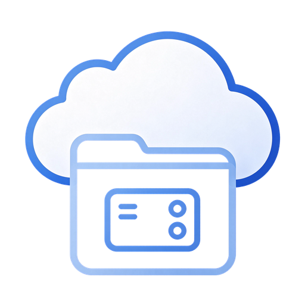

<p align="center">
  
</p>

# R6T5 Drive
R6T5 提供：[`English`](docs/README-en.md)
<p>
  <a href="https://github.com/TanchiPanda/r6t5-drive/stargazers"></a>
  <a href="https://github.com/TanchiPanda/r6t5-drive/commits/main"></a>
  <a href="https://github.com/TanchiPanda/r6t5-drive/commits/main"></a>
  <a href="https://github.com/TanchiPanda/r6t5-drive/actions/workflows/docker.yml"></a>
  <a href="LICENSE"></a>
</p>

一个可以自己部署的私人网盘：把文件放在自己的服务器上，支持多人使用、在线预览和分享。不需要买云服务，一个 Docker 容器就能跑起来。

- 在线演示：https://r6t5-drive-preview.r6t5.dpdns.org
- 源码仓库：https://github.com/TanchiPanda/r6t5-drive
- 详细部署说明：[`docs/deploy.md`](docs/deploy.md)

## 你能做什么

**日常使用**
- 上传、下载、重命名、移动、删除文件，支持多选批量操作
- 大文件分片上传，中途断线可以接着传，不用重来
- 在线看图片、视频、音频、文本、Markdown 和 PDF
- 打开 Office 文档时可以自己选阅读器（内置 PDF.js、Google Docs、Microsoft 365 等），选过一次后同类型文件会记住你的选择
- 生成分享链接：可设有效期、提取码和下载次数限制
- 删除的文件先进回收站，保留期内可以恢复，到期才彻底清除

**管理员**
- 新建用户、改密码、封禁账号；按用户组分配空间大小、单个文件上限和每周上传流量
- 可以让访客自己注册账号，也可以关掉注册
- 同一个站点里的不同目录，可以存在不同的存储位置（见下文）
- 操作记录（审计日志）可查

## 快速开始

### 方式一：Docker（推荐）

```bash
cp .env.example .env
```

打开 `.env`，至少把 `SESSION_SECRET` 换成一串随机字符（可用 `openssl rand -hex 32` 生成），然后：

```bash
docker compose up -d
```

启动后在浏览器打开 `http://服务器地址:5212` 即可。

Windows PowerShell 下也可以直接用：

```powershell
New-Item -ItemType Directory -Force -Path .\data | Out-Null
docker run -d --name r6t5-drive -p 5212:5212 -v "${PWD}\data:/app/data" ghcr.io/tanchipanda/r6t5-drive:latest
```

所有数据都保存在 `./data` 目录，备份和升级方法见 [`docs/deploy.md`](docs/deploy.md)。

### 方式二：直接运行（不用 Docker）

需要 Node.js 20 或更高版本：

```bash
npm install
npm start
```

## 第一次使用

1. 启动后，管理员密码默认自动生成一次，打印在服务端日志里，找出来登录；也可以在 `.env` 的 `ADMIN_PASSWORD` 里自己指定。
2. 登录管理后台后，按页面提示依次完成：
   - 选一个存储位置（本地文件夹 / S3 兼容存储 / 只读 GitHub 仓库）
   - 建至少一个用户组并设好限额
   - 填好站点名称和对外访问地址
3. 全部完成后，普通用户就能用邮箱注册或管理员建号登录了。

## 文件存在哪里

文件内容不一定放在本地，可以在后台选择，三类存储可以混用：

| 类型 | 能不能上传 | 适用场景 |
|---|---|---|
| 本地文件夹 | 能 | 最简单，文件就在服务器的数据目录里 |
| S3 兼容存储 | 能 | 兼容 MinIO、Cloudflare R2、阿里云 OSS、腾讯云 COS、华为云 OBS 等 |
| GitHub 仓库 | 只能下载 | 把公开仓库里的文件挂出来给人看 |

管理员可以把某个目录（或某个用户）指定到某一类存储上；只读存储里不能上传、改名或删除。

> 在线打开 Google Docs、Microsoft 365 这类外部阅读器时，需要站点有公网可访问的地址，文件链接只会短期有效（10 分钟）。

## 常见问题

**数据会丢吗？** 所有内容都在你自己的 `./data` 目录里，定时备份这个目录即可，详见部署文档。

**回收站里的文件去哪了？** 默认保留 30 天（可在 `.env` 的 `TRASH_RETENTION_DAYS` 修改），到期自动彻底删除。

**怎么升级？** 拉取新镜像后重启容器，数据目录不动即可，数据库会自动更新结构。

## 给开发者

- 后端 Node.js + Express + SQLite，前端是纯 HTML/CSS/JS，不需要打包构建
- 接口字段与错误码见 [`docs/api-contract.md`](docs/api-contract.md)
- 功能规划见 [`docs/plan.md`](docs/plan.md)，实测记录见 [`docs/verify.md`](docs/verify.md)

## 许可

- 本项目代码以 [MIT](LICENSE) 协议发布（Copyright © 2026 TanchiPanda）
- 项目附带的第三方组件（pdf.js、Monaco、epub.js 等）许可清单见 [THIRD_PARTY_NOTICES.md](THIRD_PARTY_NOTICES.md)；接入新组件时请同步登记

## 合规声明

本项目参考了同类网盘产品的常见使用方式，但代码与界面全部自研，未复制任何传染性许可（GPL 等）下的源码；运行时依赖均为 MIT / ISC / BSD 等宽松许可。
